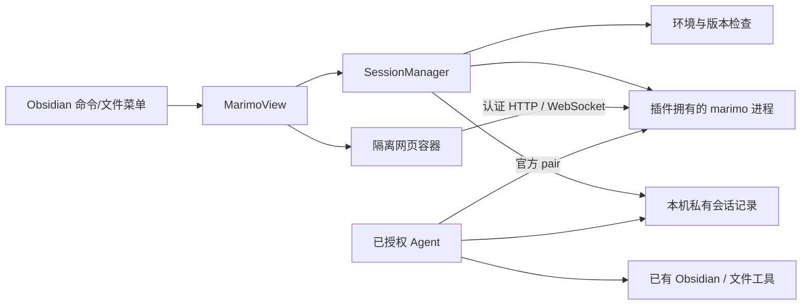

> **历史文档（已归档）**：本文记录的是「在 Obsidian 中嵌入官方 marimo 网页编辑器」路线，**已由原生 Obsidian 前端 + marimo 后端路线取代**，不再执行。原文内容保持原样，仅添加本状态标注；归档说明见同级 `history/README.md`。

# 技术架构与安全设计

## 现有基线与复用边界

`src/main.ts` 注册现有 `native-ipynb`；`src/notebook.ts` 解析 nbformat4；`src/view.ts`、`src/kernel.ts` 和 `python/kernel_bridge.py` 管理 Jupyter。保持这些文件模型与执行协议。

复用 `managed-runtime.ts` 的设备身份/拥有目录验证思路、受控子进程终止、`environment-diagnostics.ts` 脱敏、`operation-panel.ts` 日志外观与双语机制。不得为了安装 marimo 覆盖已验证 uv 校验值或调用 renderer signal 到 Electron 主进程。

新增模块集中于 `src/marimo/`，不继续把全部逻辑塞入已有 main/view/settings 大文件。



## 拟议文件责任

| 新文件 | 单一责任 |
| --- | --- |
| `src/marimo/types.ts` | 状态、身份、能力与连接契约 |
| `src/marimo/file.ts` | 静态识别、仓库内真实路径与命名检查 |
| `src/marimo/capabilities.ts` | 固定版本、CLI 功能探测与兼容性结论 |
| `src/marimo/environment.ts` | 自有可选环境的安装/选择；隔离现有 Jupyter 环境的修改 |
| `src/marimo/server.ts` | 启动、认证握手、健康检查、退出与进程树清理 |
| `src/marimo/sessions.ts` | 会话复用、引用、状态迁移和竞争保护 |
| `src/marimo/connection-store.ts` | 本机私有发现记录、过期清理与 token 文件权限 |
| `src/marimo/agent.ts` | 根据已验证能力生成官方连接说明与核验信息 |
| `src/marimo/view.ts` | Obsidian 视图、独立网页容器、焦点与关闭保护 |
| `src/marimo/settings.ts` | 可选功能开关、环境状态与诊断入口 |

在 `main.ts` 增加轻量注册/清理；只在 `preferences.ts` 与 `environment-config.ts` 增加可同步的非敏感偏好。现有环境删除钩子若目标与 marimo 环境相同，必须纳入忙碌拒绝与关闭协商，不能只保护 Jupyter。

## 版本与环境

候选版本为 `0.25.2`，仅作为 P0 起点，不是已兼容承诺。保存该版本 `edit --help`、`pair --help`、Notebook 发现与认证探测结果；滚动文档中的选项缺失即标记不支持。

P1 固定一个通过 P0 的正式 Release；禁止默认 `@latest` 或安装未审阅 main 分支。pair 不存在则 P1 可继续，P2 停在能力检查并明确说明，不用未认证私有 API 冒充支持。

首个测试解释器为 Python 3.12。默认提供独立 marimo 环境，复用已有 Python 下载能力，不在用户的 Jupyter 环境中自动新增/升级依赖。用户可显式选择已有虚拟环境，界面显示解释器和目标安装位置。安装有进度、取消、失败重试；业务包与 marimo 所在环境必须可识别。

`uv --sandbox` 的逐 Notebook 依赖环境留作后续能力；它不是操作系统安全隔离。

## 启动与所有权

使用绝对解释器和参数数组启动，无 shell 拼接。候选命令形状为：

```text
<python> -I -m marimo edit <absolute-notebook.py>
  --headless --host 127.0.0.1 --port <chosen-port>
```

认证 token 传递只采用固定版本支持的安全机制；支持 stdin/token-file 时优先使用，不把 token 放入普通日志、命令历史、同步文件或错误提示。保持认证开启，不为适配关闭 Origin/DNS rebinding 等保护。`--watch` 等选项只有在 P0 验证后加入。

端口先分配再启动仍有竞争；以最终进程监听和认证握手为准，绑定失败有限重试，不直接相信一个响应 200 的同端口陌生进程。启动超时 30 秒；停止先优雅退出，3 秒后只对自有进程树强制终止。上限可在证据基础上调整，不能变成无限重试。

对继承环境清除影响解释器/包目标的注入变量，代理按用户配置处理，日志脱敏。不能盲目更改用户全局 Python、uv、pip 或 AI 配置。

记录 sessionId、文件 realpath、解释器、服务 origin、PID 与创建时间。只有插件启动且身份仍匹配的进程可被停止。外部服务为只连接，不终止。确认文件路径在本仓库、为普通可读写文件；目录链接逃逸与云端占位文件均拒绝并说明原因。

## 会话模型

首版每个 Notebook 一个受控服务器，多个标签页共享该会话；不同文件分别运行，避免先引入跨文件内核语义。`SessionManager` 按 `(vaultId, realpath, environmentId)` 记录会话身份，但另以规范化 realpath 取得独占写者锁；更换 environmentId 不得绕过写者锁。重复打开相同文件与环境合并为同一 Promise；不同环境请求必须先完成保存、旧会话停止与锁交接，不允许两个服务同时写同一文件。

写者锁需要覆盖多个 Obsidian 窗口/插件实例；采用本机私有目录的原子锁记录，并验证创建者实例及进程创建时间。无法确认外部编辑器或外部服务是否占用该文件时明确提示冲突，不宣称可以控制所有外部程序。

状态迁移：

```text
idle → provisioning → starting → connecting → ready
ready → disconnected → connecting / failed
ready / disconnected → stopping → stopped
任意准备阶段 → canceled（没有活动进程残留）
failed / stopped / canceled → 显式重试
```

每次启动有 generation；晚到的旧响应不得覆盖新会话。新视图、延迟加载视图和窗口关闭均不得假定实例方法已存在。窗口在确认、能力探测、安装、准备阶段关闭时停止后续动作；已经开始的必要资源清理仍须完成。

执行中的停止、环境删除或更换要先协商；不让安装/卸载在活动 marimo kernel 上直接修改环境。Agent 连接引用不能凭空推断：只计可验证的连接/用户保留授权；无法获知客户端生命周期时展示不确定状态并提供明确停止入口。

## 网页隔离与嵌入阻断条件

优先验证跨源 iframe，明确禁用 Node 能力、无文件系统 preload、无通用 JS→插件执行桥。允许的导航目标仅为该会话 origin 和验证过的路径；外链交给系统浏览器并保留用户触发要求。

保存、剪贴板、下载、WebSocket、认证 cookie/token、CSP 与框架响应头在 Obsidian 实机验证。只按实际需要开放 iframe 能力；不照抄示例中的 microphone/popups 等全部权限。不得设置 webSecurity=false 或关闭宿主 CSP 作为发布方案。

若必须更换网页容器，作为明确架构变更审查；不能直接启用高权限 Electron webview。若隔离与编辑不可同时满足，停止内嵌路线并保留外部打开降级。

## 文件写入、信任与保存

marimo 是源文件唯一主要写入方。插件不反向序列化 `@app.cell`，不把文件载入当作执行授权。仅静态读取结构；显式信任项目后，才允许运行其 Python 与相关配置。

P0 必须实测官方保存行为、未保存状态或离开保护。在没有受支持保存信号时，不提供“保存成功”判断；要求用户在官方编辑器保存确认后关闭。无法防止静默丢失编辑则 P1 发布阻断。

文件被外部编辑时采用已验证的官方 watch/冲突提示；没有冲突协议时阻止并行源码编辑。重命名/移动时暂停使用旧路径，确认新目标归属后重新连接，绝不继续保存到已被其他文件占用的路径。

当前 ipynb 的 Properties、Dataview、安全静态输出与恢复缓存不直接套用到 marimo。尤其不能用静态输出 sanitizer 处理完整交互编辑器，也不能为了交互把 ipynb 输出安全过滤关闭。

## 明确的信任边界

文件白名单、Agent 授权和虚拟环境只是应用层控制；运行的任意 Python 仍能访问当前用户有权限的本机资源。若要限制不可信 Python，需另行设计容器/OS 沙箱，不在首版中承诺。
